# Phone AI Audit

<h3 align="center">《人不在工位，我靠手机遥控 AI 一键上线》</h3>

<p align="center">
  <br />
  <sub>老板查岗怒吼「人呢？！」，你在海边喝着椰子水手机一点「允许 ✓」，工位 Mac 上的 AI 三秒写完自动部署，老板当场瞳孔地震！</sub>
</p>

> **「什么？！他人都去海边度假了，这三万行需求怎么全上线了？！」**
>
> 别人苦守工位熬到凌晨三点给 AI 点确认，你却在海边躺吊床、地铁扶吊环、被窝撸大橘——手机轻轻一点，远端 Mac 上的 **Claude Code / OpenAI Codex / Antigravity** 瞬间满血开工，审批、终端、看代码、Diff、Commit、Push 一条龙全包！

### 🔥 五大逆天金手指

- **👑 三大 AI 统统归你差遣**：全面接管 **Claude Code**、**OpenAI Codex**、**Antigravity (`agy`)**，任务完成、突发报错、等待回答、高危权限审批，第一时间秒推到你手里；Antigravity 更配备 **`PreToolUse` 全量规则 + Tmux 终端审批守卫**双层防漏引擎，实时捕获并双向联动终端确认框；
- **⚡ 通知栏一键生杀大权（双端同步 + 超时自动放行）**：锁屏下拉直接点 **允许 / 拒绝（顺手回一句理由）/ 退回电脑**；开启 **双端同步 (`both`)** 模式后，Mac 右上角原生悬浮窗与手机通知栏同步弹起，**哪边先点以哪边为准，另一端秒消失**；支持在手机端自定义弹窗超时时长（默认 **30 秒**，Mac 与手机实时同步）及**超时自动确认授权开关（默认开启）**，超时自动放行、同步消除双端弹窗并自动标为已读，删库跑路等高危命令自带指纹/面容二次门禁；
- **🕶️ 加密暗道直连 Mac 终端**：内置 `xterm.js` + `tmux` 反向隧道，**无需暴露 Mac SSH 22 端口**，随时切进正在干活的 AI 终端，还能手机一键拉起新终端（Mac 端同步弹出窗口），自带可拖动多组方向键/Agent 快捷键手柄（含 `Shift+Tab`、`Ctrl+O`、`Ctrl+G` 等）、**完整终端虚拟全键盘**（粘滞 `Shift`/`Ctrl`/`Alt`、`Fn` F1–F12、符号层）与独立中文提示词输入条；
- **📂 远程翻代码、下载文件 & 一键 Push**：支持按需流式预览不落盘，也支持**一键分片流式下载任意文件到手机 `Download/PhoneAiAudit/`（带实时进度条、取消清理、下载后直接打开或分享）**；内置文件名与 `rg` 全文秒搜、代码语法高亮预览、在线改代码（保存前强制 Diff + SHA256 乐观锁防误覆盖）、Markdown / 图片 / PDF / Office / 音视频直看，更有移动端 **Git 工作台**（红绿 Diff、精准勾选批量 Commit、安全 Push）；
- **📊 零负担 Agent 用量 & 配额看板（Mac 网页 + 手机 App 双端同步）**：`mac-agent` 内置增量游标日志扫描器与持久化聚合缓存（默认本机 `http://127.0.0.1:9878`，手机 App 内置「用量」Tab），一次查看 **Claude Code / Codex / Antigravity** 的 **近 5 小时 / 今日 / 本周 / 本月 / 历史总用量**、**5 小时与周重置倒计时**、**分模型明细** 与 **近 14 天趋势图**，待机 0% CPU、日常增量刷新毫秒级。

---

## 随时随地 Vibe Coding

> **「电脑交给 AI 疯狂写码，生杀大权握在手机——人在哪儿，工位就在哪儿！」**

<table>
  <tr>
    <td align="center" width="33%">
      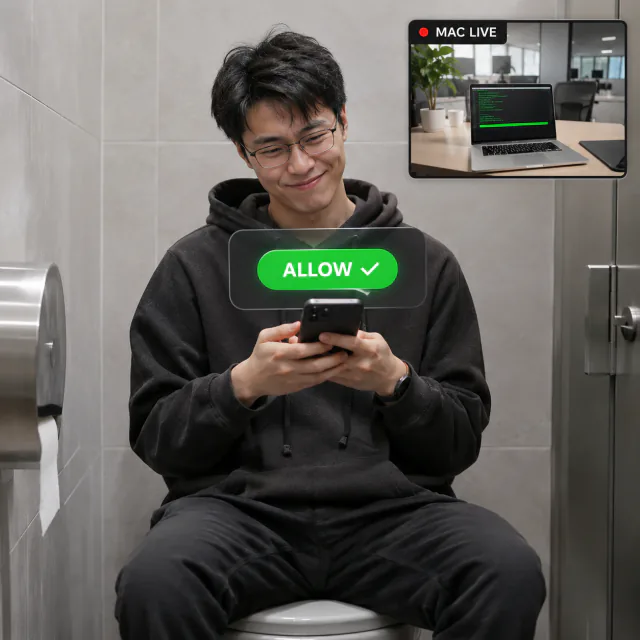<br />
      <strong>🔥《带薪蹲坑，遥控 AI 狂写代码》</strong><br />
      <sub>锁屏弹出权限请求？微微一笑点下「允许 ✓」，工位 Mac 继续狂飙，灵感与进度双丰收</sub>
    </td>
    <td align="center" width="33%">
      <br />
      <strong>🚇《早高峰地铁，单手优雅发新版》</strong><br />
      <sub>全车厢打工人昏昏欲睡，唯独你戴上耳机单手扶吊环，嘴角微扬点下「批准上线 ✓」</sub>
    </td>
    <td align="center" width="33%">
      <br />
      <strong>🐱《被窝撸猫，AI 干完一千行》</strong><br />
      <sub>裹紧毛毯怀抱大橘，奶茶还没喝完，里屋 AI 已飙出 <code>+999 -12</code>，手机顺手「一键推送 ↑」</sub>
    </td>
  </tr>
</table>

---

## 实机效果演示

### 双端同步审批：Mac 浮窗 × 手机通知栏实时联动

<p align="center">
  <br />
  <sub>AI 刚触发高危命令，Mac 右上角原生悬浮窗与手机通知栏同时拉响警报；手机随手点一下「允许」，Mac 浮窗当场消失、任务无缝继续！</sub>
</p>

### 1. 通知栏一键发号施令，多 AI 消息统一归档

<table>
  <tr>
    <td align="center" width="25%">
      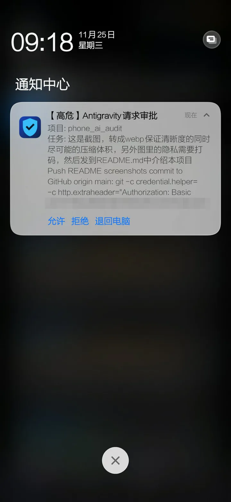<br />
      <sub>通知栏直接批复「允许 / 拒绝 / 退回电脑」</sub>
    </td>
    <td align="center" width="25%">
      <br />
      <sub>活干完秒报喜，一键直达现场终端</sub>
    </td>
    <td align="center" width="25%">
      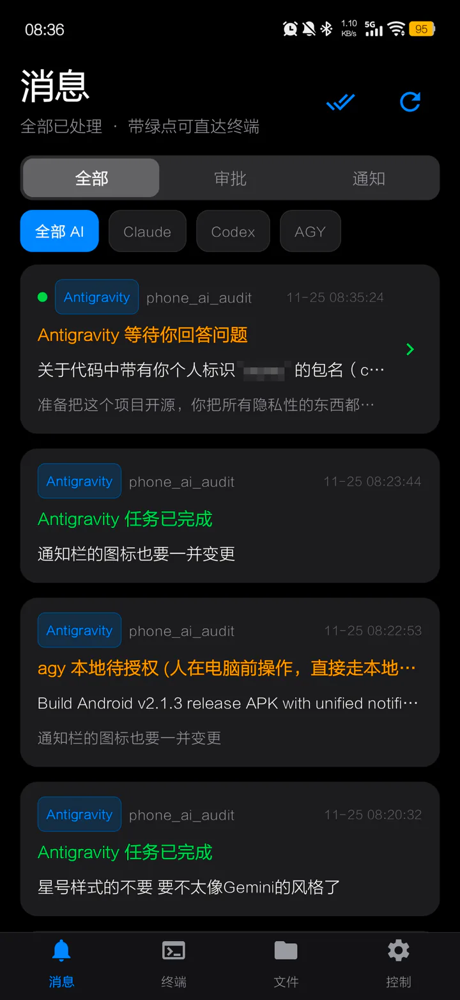<br />
      <sub>三大 AI 战报汇总，绿点秒切终端</sub>
    </td>
    <td align="center" width="25%">
      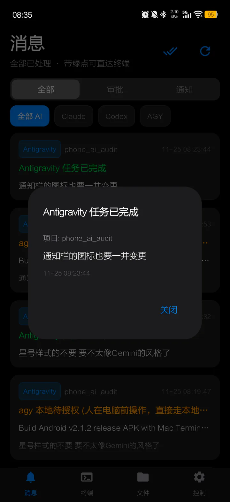<br />
      <sub>任务战果与报错详情一览无余</sub>
    </td>
  </tr>
</table>

<p align="center">
  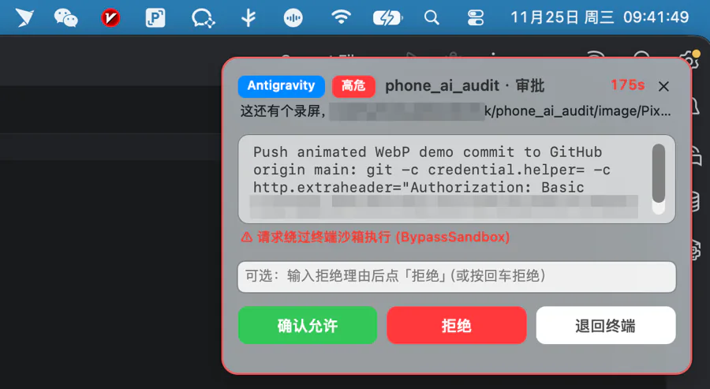<br />
  <sub>人在电脑前也不耽误：双端同步模式下的 Mac 原生悬浮审批卡（高危红框、倒计时、拒绝理由、一键退回终端全配齐）</sub>
</p>

### 2. 加密暗道接管终端，手机一声令下 Mac 自动弹窗

<table>
  <tr>
    <td align="center" width="33%">
      <br />
      <sub>活跃 tmux 会话池，手机一键新开终端</sub>
    </td>
    <td align="center" width="33%">
      <br />
      <sub>xterm.js 丝滑实况终端 + 中文提示词直发条</sub>
    </td>
    <td align="center" width="33%">
      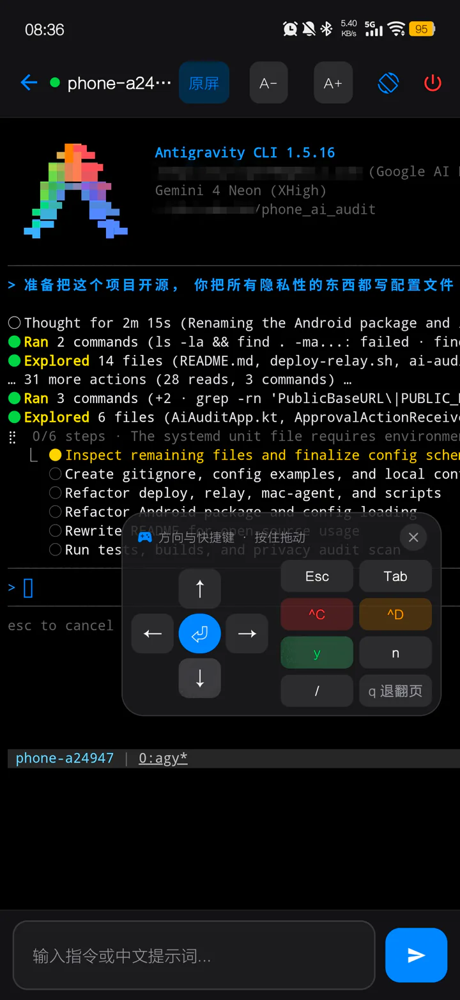<br />
      <sub>悬浮方向键与 Ctrl+C / Tab 快捷键手柄</sub>
    </td>
  </tr>
</table>

<p align="center">
  <br />
  <sub>手机端新建终端瞬间，远端 Mac 同步自动弹出 Terminal 窗口并共享同一 tmux 画面，回到工位无缝续写</sub>
</p>

### 3. 文件免下载随手查，躺平也能在线改代码

<table>
  <tr>
    <td align="center" width="33%">
      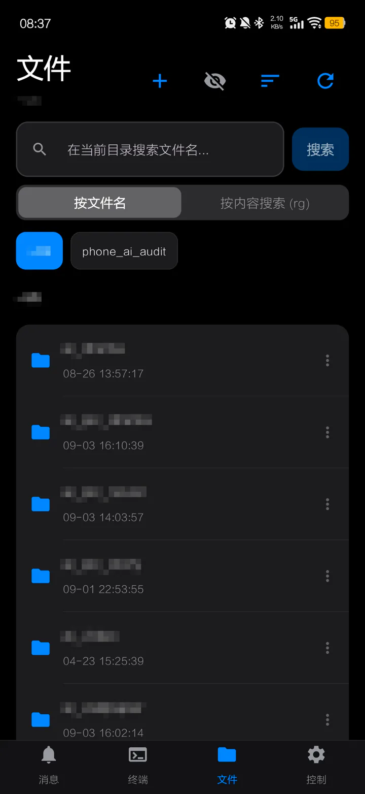<br />
      <sub>沙箱目录按需流式浏览 + 文件名 / rg 全文秒搜</sub>
    </td>
    <td align="center" width="33%">
      <br />
      <sub>离线代码语法高亮与行号丝滑阅读</sub>
    </td>
    <td align="center" width="33%">
      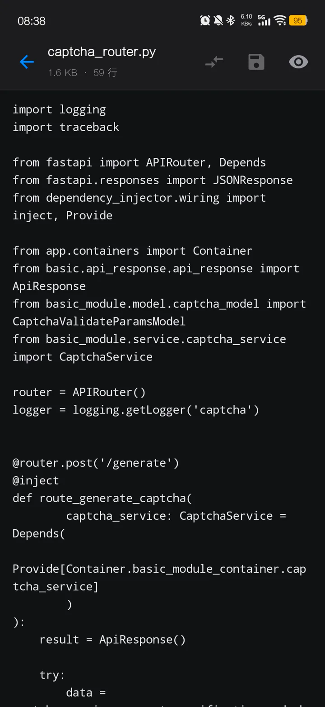<br />
      <sub>在线改代码（保存前强制 Diff + 乐观锁护体）</sub>
    </td>
  </tr>
</table>

### 4. 手机端 Git 工作台，看 Diff · 批量 Commit · 安全 Push

<table>
  <tr>
    <td align="center" width="33%">
      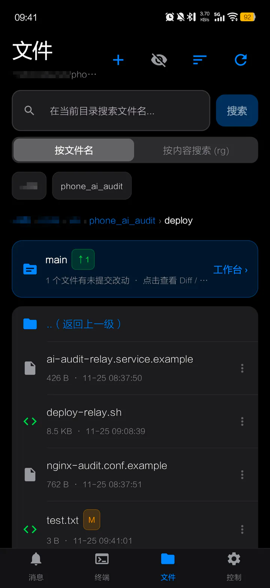<br />
      <sub>自动嗅探 Git 仓库，未提交改动一眼锁定</sub>
    </td>
    <td align="center" width="33%">
      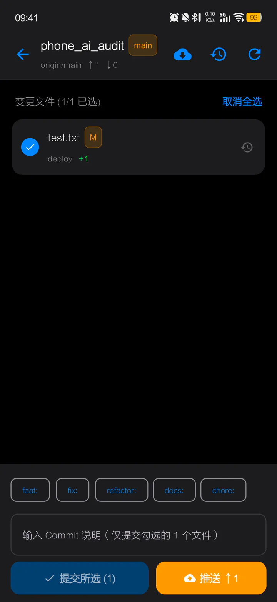<br />
      <sub>精准勾选批量 Commit，优雅一键 Push</sub>
    </td>
    <td align="center" width="33%">
      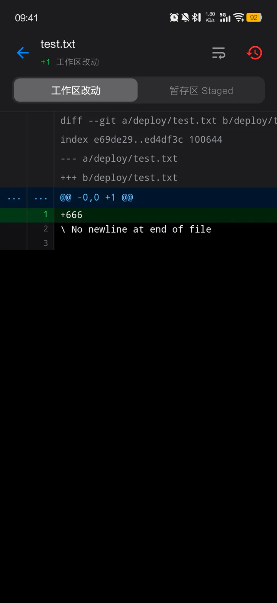<br />
      <sub>工作区 / 暂存区红绿高亮 Diff 逐行审阅</sub>
    </td>
  </tr>
</table>

### 5. 双端 Agent 用量与实时配额看板：Mac 网页 × 手机 App 同步掌握

<p align="center">
  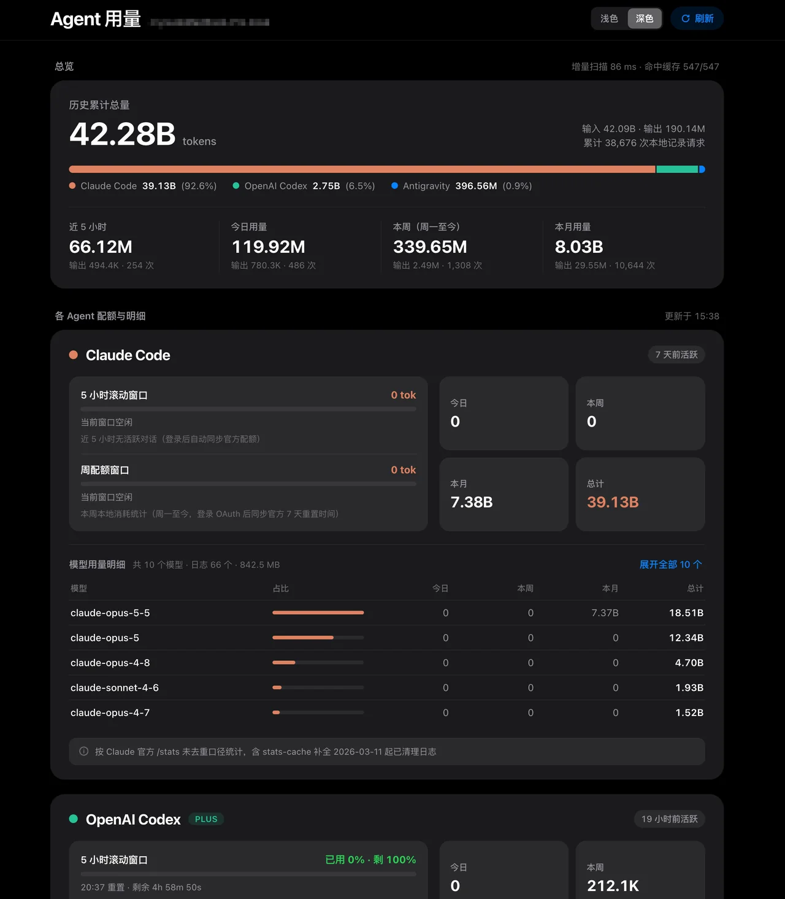<br />
  <sub>Mac 本机 iOS 风格用量看板（<code>http://127.0.0.1:9878</code>，支持明暗切换）：一次汇总 Claude Code、OpenAI Codex（含 <code>.jsonl.zst</code> 归档）与 Antigravity 全量 Token、官方配额进度、重置倒计时与分模型明细</sub>
</p>

<p align="center">
  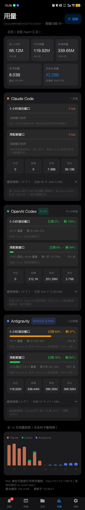<br />
  <sub>手机 App「用量」Tab 随时随地查账：近 5 小时 / 今日 / 本周 / 本月 / 历史总量、Codex &amp; Antigravity 官方实时配额倒计时与近 14 天趋势柱图一览无余</sub>
</p>

### 6. 终极中控台：审批模式 · 一键熔断 · 指纹锁全掌控

<p align="center">
  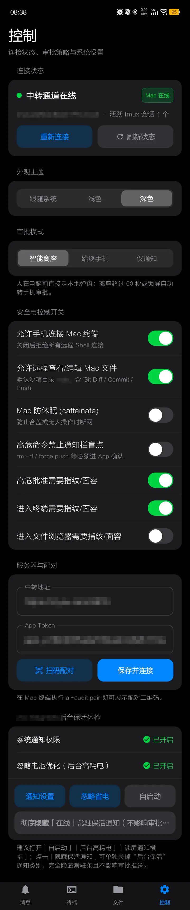<br />
  <sub>通道心跳、明暗主题、四种审批模式、远程能力一键熔断、生物识别门禁、扫码秒连与保活体检一站式拿捏</sub>
</p>

---

## 目录结构

```text
phone_ai_audit/
├── config.env.example                  # 统一构建与部署配置模板（复制为 config.env 后使用，已 gitignore）
├── docs/
│   ├── assets/                         # README 展示用 Vibe Coding 动图与场景海报 (WebP)
│   └── screenshots/                    # README 实机脱敏 WebP 截图与动态演示
├── relay/                              # Linux Go 中转服务 (ai-audit-relay, SQLite WAL, 极低内存占用)
│   └── .env.example                    # Relay 运行时环境变量模板
├── mac-agent/                          # Mac 守护进程 (ai-audit-agent) + 用量网页看板 + Hook 适配器 + 悬浮审批窗 + 控制 CLI
│   ├── config.example.json             # Mac 端配置模板 (~/.config/ai-audit/config.json)
│   ├── internal/usage/                 # 增量游标用量统计引擎与内嵌本机网页看板 (127.0.0.1:9878)
│   ├── prompt/main.swift               # 原生 macOS AppKit 悬浮审批卡片 (ai-audit-prompt)
│   └── scripts/                        # install.sh / rollback.sh / ai-tmux / tmux.conf
├── android/                            # 原生 Android App (Kotlin + Jetpack Compose)
│   ├── local.properties.example        # Android SDK 路径模板
│   └── build-apk.sh                    # Release APK 命令行打包脚本
├── deploy/                             # systemd / Nginx 模板与一键部署脚本
│   ├── ai-audit-relay.service.example
│   ├── nginx-audit.conf.example
│   └── deploy-relay.sh
└── scripts/                            # 端到端联通性校验脚本
```

---

## 🔐 隐私与本地配置隔离

> 真正的大佬，绝不把个人服务器、域名、证书和 Token 传上 GitHub！所有隐私配置全部隔离在本地文件并已加入 `.gitignore`：

| 模板文件（已入库） | 个人配置文件（已 gitignore） | 用途 |
| :--- | :--- | :--- |
| `config.env.example` | `config.env` | 部署脚本、Mac 安装脚本、Android 构建脚本的统一配置 |
| `relay/.env.example` | `relay/.env` | 本地或手动运行 `ai-audit-relay` 时的环境变量与 Token |
| `mac-agent/config.example.json` | `~/.config/ai-audit/config.json`（或 `mac-agent/config.json`） | Mac 端中转地址、Token、Unix Socket 与文件沙箱根目录 `file_roots` |
| `android/local.properties.example` | `android/local.properties` | Android SDK 本地路径 |
| `deploy/ai-audit-relay.service.example` | `deploy/ai-audit-relay.service`（可选覆盖） | systemd 服务模板（默认由 `deploy-relay.sh` 根据 `config.env` 自动渲染） |
| `deploy/nginx-audit.conf.example` | `deploy/nginx-audit.conf`（可选覆盖） | Nginx HTTPS/WSS 反代模板（默认由 `deploy-relay.sh` 自动渲染） |

---

## 🚀 三分钟极速部署

### 第 1 步：初始化配置文件

```bash
cp config.env.example config.env
cp android/local.properties.example android/local.properties
```

按你的实际环境填好 `config.env`（域名、端口、SSH 主机、TLS 证书路径、允许手机翻阅的 `MAC_FILE_ROOTS` 等）和 `android/local.properties`（`sdk.dir`）。

### 第 2 步：架起加密信号塔（编译并部署中转服务 `relay/`）

前置条件：一台有公网域名和有效 TLS 证书（如 Let's Encrypt）的 Linux 服务器，并放行 `config.env` 里配置的 `RELAY_PUBLIC_PORT`（默认 `9876`）。

```bash
mkdir -p dist

# 交叉编译 Linux amd64 二进制
(cd relay && GOOS=linux GOARCH=amd64 CGO_ENABLED=0 go build -o ../dist/ai-audit-relay-linux-amd64 ./cmd/relay)

# 根据 config.env 一键部署 systemd + Nginx，并自动生成随机 MAC_TOKEN / APP_TOKEN 写入 Mac 配置
./deploy/deploy-relay.sh
```

> 若手动部署，可参考 `relay/.env.example`、`deploy/ai-audit-relay.service.example` 与 `deploy/nginx-audit.conf.example`。

### 第 3 步：给 Mac 装上外挂大脑（编译并安装 Mac 守护进程与 Hook `mac-agent/`）

前置条件：已安装 Go 1.24+、Homebrew、`tmux`（可选 `ripgrep`、`poppler`、`ffmpeg` 以解锁全文搜索、PDF 渲染和媒体预览）。

```bash
# 编译 Mac 端组件（含原生双端悬浮审批弹窗）
(cd mac-agent && go build -o ../dist/ai-audit-agent ./cmd/ai-audit-agent)
(cd mac-agent && go build -o ../dist/ai-audit-hook ./cmd/ai-audit-hook)
(cd mac-agent && go build -o ../dist/ai-audit ./cmd/ai-audit)
swiftc -O mac-agent/prompt/main.swift -o dist/ai-audit-prompt

# 若未通过 deploy-relay.sh 自动生成配置，请手动创建 ~/.config/ai-audit/config.json
# cp mac-agent/config.example.json ~/.config/ai-audit/config.json

# 安装二进制、tmux 配置、三端 Hook（自动备份原配置）并启动 launchd 守护进程
./mac-agent/scripts/install.sh
```

### 第 4 步：拿到掌中遥控器（编译 Android App `android/`）

前置条件：JDK 17 + Android SDK（Command-line Tools 或 Android Studio）。

```bash
./android/build-apk.sh
```

把生成的 `dist/PhoneAiAudit-latest.apk` 装进手机，打开 App → **「控制」** → **「扫码配对」**，对着 Mac 端 `ai-audit pair` 弹出的二维码一扫——**大功告成，随时随地开启躺平写码人生！**

---

## 👑 日常操作手册

### 1. Mac 端核心口令

```bash
# 查看中转、手机在线状态、当前审批模式与活跃 tmux 会话
ai-audit status

# 查看 Claude Code / Codex / Antigravity（支持多账号独立配额）用量与 5h / 周重置倒计时
ai-audit usage

# 在本机浏览器一键打开 Agent 用量网页看板（默认 http://127.0.0.1:9878）
ai-audit web

# Antigravity (agy) 多账号钥匙串管理、登录到期提醒与一键切换新开终端（零明文 Token 落盘）
ai-audit agy                        # 查看已保存账号、当前活跃账号(*)、到期状态与实时配额
ai-audit agy save main              # 将当前已登录账号保存到 macOS Keychain 档案
ai-audit agy login work             # 清空槽位、弹出新终端登录第二个号并自动保存档案
ai-audit agy work                   # 一键切换全局账号并弹出新的 tmux 终端运行 agy
ai-audit agy ttl work 7d            # 自定义登录到期 / 续登提醒周期（支持 7d/14d/30d/auto/off）

# 切换四种审批模式：
#   auto   = 智能离座（人在电脑前走本地弹窗，离座 60s 或锁屏自动转交手机）
#   both   = 双端同步（Mac 右上角悬浮窗与手机通知栏同时弹出，先点为准、另一端秒消失）
#   phone  = 全程手机掌权（无论人在哪儿，统统发到手机审批）
#   notify = 仅收战报不阻塞
ai-audit mode auto
ai-audit mode both
ai-audit mode phone
ai-audit mode notify

# 开启/关闭 Mac 防休眠 (caffeinate)，离座也不怕电脑睡着
ai-audit awake on
ai-audit awake off

# 一键开启/熔断远程终端与远程文件权限
ai-audit terminal on
ai-audit terminal off
ai-audit files on
ai-audit files off

# 生成手机 App 扫码配对二维码
ai-audit pair

# 联通测试：发送测试消息 / 发起测试审批
ai-audit test-msg
ai-audit test-approve
```

### 2. 让手机随时空降 AI 终端（`ai-tmux` 无感封装）

在项目目录里用 `ai-tmux` 启动 AI（默认开好鼠标滚轮与剪贴板同步，Mac 上用着完全无感）：

```bash
ai-tmux claude      # 启动/进入 claude-<当前目录名> 会话
ai-tmux codex       # 启动/进入 codex-<当前目录名> 会话
ai-tmux agy         # 启动/进入 agy-<当前目录名> 会话
ai-tmux             # 启动/进入当前目录的普通 shell 会话
```

之后不管你是在厕所、地铁还是沙滩上，打开手机 App **「终端」** Tab，或在任意消息/审批卡片上点 **「进终端」**，直接空降同一画面实时指挥！

### 3. 首次解锁 Codex 审批钩子

Codex 对自定义 `hooks.json` 有首次信任校验。安装完成后打开一次 `codex` CLI 并输入 `/hooks`，确认信任 `~/.codex/hooks.json` 即可生效。

### 4. Android 后台不掉线秘籍（保活建议）

本 App 通过前台服务直连 WebSocket 长连接（不依赖 Google FCM）。打开 App → **「控制」** Tab 底部保活体检卡，按系统指引点亮四项护盾：

1. 允许通知，并确保「AI 审批与紧急提醒」渠道开启 **悬浮横幅** 与 **锁屏显示**；
2. 电池 / 省电策略 → **忽略电池优化**（允许后台高耗电 / 无限制）；
3. 权限管理 → 开启 **自启动**；
4. 多任务界面下拉 **锁定** App 卡片（可选，防手滑清后台）。

### 5. 一键撤退回滚（卸载 Mac Hook 与守护进程）

```bash
./mac-agent/scripts/rollback.sh
```

---

## License

本项目基于 [MIT License](LICENSE) 开源。

