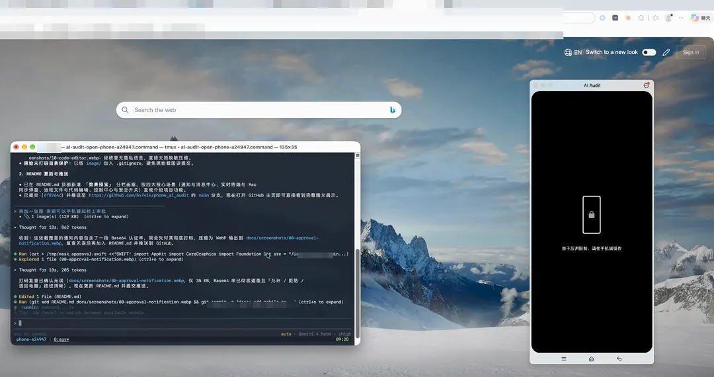
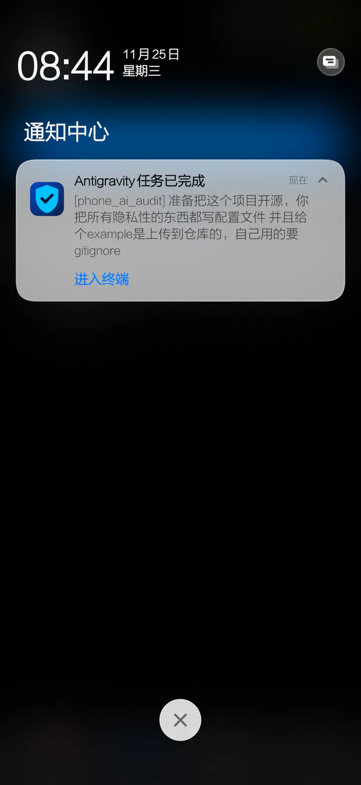
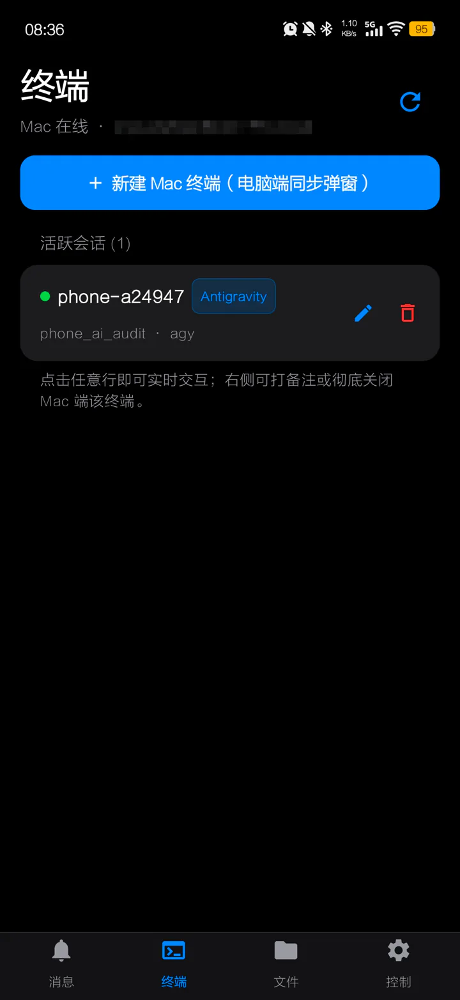
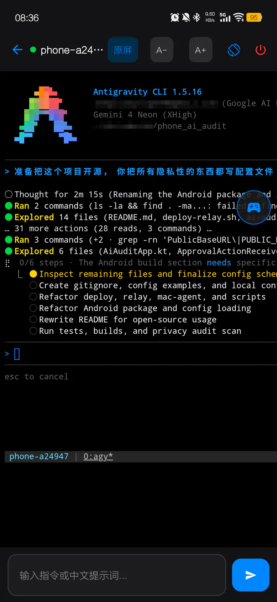
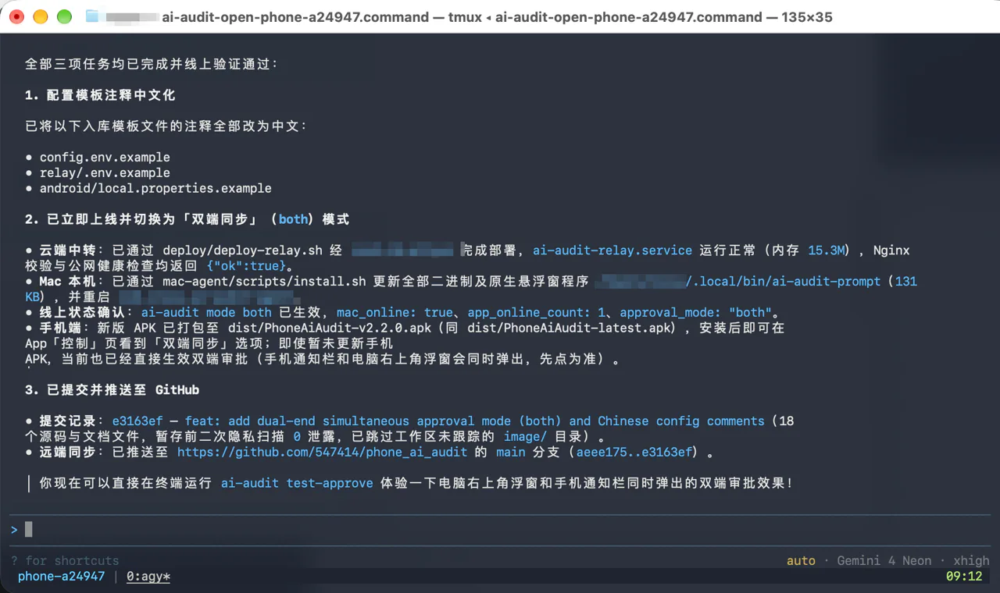
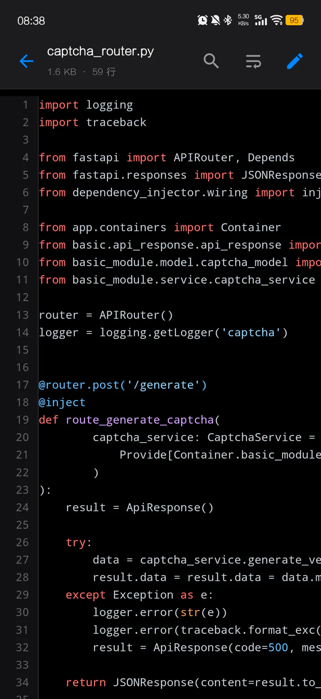

# Phone AI Audit

一套面向个人开发工作流的移动端 AI 通知、远程审批、实时交互终端与远程文件 / Git 工作台系统：

- **统一接管多 AI 助手**：支持 **Claude Code**、**OpenAI Codex**、**Antigravity (`agy`)** 的任务完成 / 异常 / 等待回答 / 权限审批消息；
- **多模式远程审批**：支持手机通知栏直接点 **允许 / 拒绝（内联输入理由）/ 退回电脑**，并提供 **双端同步 (`both`)** 模式（Mac 屏幕右上角原生悬浮窗与手机通知栏同时弹出，先点为准、另一端自动消失），高危操作支持生物识别二次确认；
- **加密反向隧道实时终端**：内置 `xterm.js` + `tmux` 联动终端，无需暴露 Mac SSH 22 端口，支持随时接入正在运行的 AI 终端或在手机端一键新建 Mac 终端（电脑端自动同步弹出窗口），配可拖动悬浮方向键 / 快捷键手柄与独立中文提示词输入框；
- **远程免下载文件浏览 & Git 工作台**：按需流式传输、不落盘，支持文件名与 `rg` 全文搜索、代码语法高亮预览、在线编辑（保存前 Diff + SHA256 乐观锁防覆盖）、Markdown / 图片 / PDF / Excel / Word / PPT / 音视频预览，以及 Git Diff / 批量精准 Commit / 安全 Push。

---

## 效果预览

### 实机动态演示：双端同步审批（Mac 浮窗 + 手机通知栏实时联动）

<p align="center">
  <br />
  <sub>AI 触发高危操作时，Mac 屏幕右上角原生悬浮窗与手机通知栏同时弹出；手机一键点击「允许」后，Mac 悬浮窗立即自动消失并继续执行任务</sub>
</p>

### 1. 通知栏直接审批与统一消息中心

<table>
  <tr>
    <td align="center" width="25%">
      <br />
      <sub>通知栏直接点「允许 / 拒绝 / 退回电脑」</sub>
    </td>
    <td align="center" width="25%">
      <br />
      <sub>任务完成推送与一键进入终端</sub>
    </td>
    <td align="center" width="25%">
      <br />
      <sub>多 AI 统一消息流与绿点直达终端</sub>
    </td>
    <td align="center" width="25%">
      <br />
      <sub>任务完成与异常详情弹窗</sub>
    </td>
  </tr>
</table>

### 2. 实时交互终端与 Mac 端同步弹窗

<table>
  <tr>
    <td align="center" width="33%">
      <br />
      <sub>活跃 tmux 会话池与一键新建终端</sub>
    </td>
    <td align="center" width="33%">
      <br />
      <sub>xterm.js 实时终端与中文提示词输入条</sub>
    </td>
    <td align="center" width="33%">
      <br />
      <sub>可拖动悬浮方向键与常用快捷键手柄</sub>
    </td>
  </tr>
</table>

<p align="center">
  <br />
  <sub>手机新建终端时，Mac 端自动同步弹出 Terminal 窗口并共享同一 tmux 会话</sub>
</p>

### 3. 远程免下载文件浏览、代码高亮与在线编辑

<table>
  <tr>
    <td align="center" width="33%">
      <br />
      <sub>沙箱目录浏览与文件名 / rg 内容检索</sub>
    </td>
    <td align="center" width="33%">
      <br />
      <sub>离线代码语法高亮与行号阅读器</sub>
    </td>
    <td align="center" width="33%">
      <br />
      <sub>远程在线编辑（保存前 Diff 与乐观锁）</sub>
    </td>
  </tr>
</table>

### 4. 控制中心、审批模式与安全开关

<p align="center">
  <br />
  <sub>通道状态、主题切换、审批模式、远程能力熔断、指纹门禁、扫码配对与后台保活体检</sub>
</p>

---

## 目录结构

```text
phone_ai_audit/
├── config.env.example                  # 统一构建与部署配置模板（复制为 config.env 后使用，已 gitignore）
├── docs/screenshots/                   # README 展示用脱敏 WebP 截图
├── relay/                              # Linux Go 中转服务 (ai-audit-relay, SQLite WAL, 低内存占用)
│   └── .env.example                    # Relay 运行时环境变量模板
├── mac-agent/                          # Mac 守护进程 (ai-audit-agent) + Hook 适配器 + 悬浮审批窗 + 控制 CLI
│   ├── config.example.json             # Mac 端配置模板 (~/.config/ai-audit/config.json)
│   ├── prompt/main.swift               # 原生 macOS AppKit 悬浮审批卡片 (ai-audit-prompt)
│   └── scripts/                        # install.sh / rollback.sh / ai-tmux / tmux.conf
├── android/                            # 原生 Android App (Kotlin + Jetpack Compose)
│   ├── local.properties.example        # Android SDK 路径模板
│   └── build-apk.sh                    # Release APK 命令行打包脚本
├── deploy/                             # systemd / Nginx 模板与一键部署脚本
│   ├── ai-audit-relay.service.example
│   ├── nginx-audit.conf.example
│   └── deploy-relay.sh
└── scripts/                            # 端到端联通性校验脚本
```

---

## 配置说明（隐私与本地配置隔离）

所有与个人服务器、域名、证书、Token、本地目录和代理相关的配置均通过本地配置文件管理，且已列入 `.gitignore` 防止误提交：

| 模板文件（已入库） | 个人配置文件（已 gitignore） | 用途 |
| :--- | :--- | :--- |
| `config.env.example` | `config.env` | 部署脚本、Mac 安装脚本、Android 构建脚本的统一配置 |
| `relay/.env.example` | `relay/.env` | 本地或手动运行 `ai-audit-relay` 时的环境变量与 Token |
| `mac-agent/config.example.json` | `~/.config/ai-audit/config.json`（或 `mac-agent/config.json`） | Mac 端中转地址、Token、Unix Socket 与文件沙箱根目录 `file_roots` |
| `android/local.properties.example` | `android/local.properties` | Android SDK 本地路径 |
| `deploy/ai-audit-relay.service.example` | `deploy/ai-audit-relay.service`（可选覆盖） | systemd 服务模板（默认由 `deploy-relay.sh` 根据 `config.env` 自动渲染） |
| `deploy/nginx-audit.conf.example` | `deploy/nginx-audit.conf`（可选覆盖） | Nginx HTTPS/WSS 反代模板（默认由 `deploy-relay.sh` 自动渲染） |

---

## 快速开始

### 1. 初始化配置文件

```bash
cp config.env.example config.env
cp android/local.properties.example android/local.properties
```

按你的实际环境编辑 `config.env`（域名、端口、SSH 主机、TLS 证书路径、允许手机访问的 `MAC_FILE_ROOTS` 等）和 `android/local.properties`（`sdk.dir`）。

### 2. 编译并部署中转服务 (`relay/`)

前置条件：一台具有公网域名和有效 TLS 证书（如 Let's Encrypt）的 Linux 服务器，并放行你在 `config.env` 中配置的 `RELAY_PUBLIC_PORT`（默认 `9876`）。

```bash
mkdir -p dist

# 交叉编译 Linux amd64 二进制
(cd relay && GOOS=linux GOARCH=amd64 CGO_ENABLED=0 go build -o ../dist/ai-audit-relay-linux-amd64 ./cmd/relay)

# 根据 config.env 一键部署 systemd + Nginx，并自动生成随机 MAC_TOKEN / APP_TOKEN 写入 Mac 配置
./deploy/deploy-relay.sh
```

> 若手动部署，可参考 `relay/.env.example`、`deploy/ai-audit-relay.service.example` 与 `deploy/nginx-audit.conf.example`。

### 3. 编译并安装 Mac 端守护进程与 Hook (`mac-agent/`)

前置条件：已安装 Go 1.24+、Homebrew、`tmux`（可选 `ripgrep`、`poppler`、`ffmpeg` 以启用全文搜索、PDF 渲染和媒体预览）。

```bash
# 编译 Mac 端组件（含原生双端悬浮审批弹窗）
(cd mac-agent && go build -o ../dist/ai-audit-agent ./cmd/ai-audit-agent)
(cd mac-agent && go build -o ../dist/ai-audit-hook ./cmd/ai-audit-hook)
(cd mac-agent && go build -o ../dist/ai-audit ./cmd/ai-audit)
swiftc -O mac-agent/prompt/main.swift -o dist/ai-audit-prompt

# 若未通过 deploy-relay.sh 自动生成配置，请手动创建 ~/.config/ai-audit/config.json
# cp mac-agent/config.example.json ~/.config/ai-audit/config.json

# 安装二进制、tmux 配置、三端 Hook（自动备份原配置）并启动 launchd 守护进程
./mac-agent/scripts/install.sh
```

### 4. 编译 Android App (`android/`)

前置条件：JDK 17 + Android SDK（Command-line Tools 或 Android Studio）。

```bash
./android/build-apk.sh
```

安装生成的 `dist/PhoneAiAudit-latest.apk` 到手机，打开 App → **「控制」** → **「扫码配对」**，扫描 Mac 端 `ai-audit pair` 输出的二维码即可完成连接。

---

## 日常使用指南

### 1. Mac 端常用命令

```bash
# 查看中转、手机在线状态、当前审批模式与活跃 tmux 会话
ai-audit status

# 切换审批模式：
#   auto   = 智能离座（电脑前直接走本地弹窗，离座 60s 或锁屏自动转手机）
#   both   = 双端同步（电脑屏幕右上角悬浮窗与手机通知栏同时弹出审批，哪边先点以哪边为准，另一端自动消失）
#   phone  = 始终走手机审批
#   notify = 仅收消息不阻塞
ai-audit mode auto
ai-audit mode both
ai-audit mode phone
ai-audit mode notify

# 开启/关闭 Mac 防休眠 (caffeinate)
ai-audit awake on
ai-audit awake off

# 开启/关闭远程终端 / 远程文件总开关
ai-audit terminal on
ai-audit terminal off
ai-audit files on
ai-audit files off

# 生成手机 App 扫码配对二维码
ai-audit pair

# 发送联通测试消息 / 发起测试审批
ai-audit test-msg
ai-audit test-approve
```

### 2. 让手机随时接管电脑上的 AI 终端（`tmux` 无感封装）

在项目目录下使用 `ai-tmux` 启动 AI（默认开启鼠标滚轮与剪贴板同步）：

```bash
ai-tmux claude      # 启动/进入 claude-<当前目录名> 会话
ai-tmux codex       # 启动/进入 codex-<当前目录名> 会话
ai-tmux agy         # 启动/进入 agy-<当前目录名> 会话
ai-tmux             # 启动/进入当前目录的普通 shell 会话
```

此后在手机 App 的 **「终端」** Tab，或者任意审批/消息卡片上点 **「进终端」**，即可直接接入同一终端画面并实时交互。

### 3. 首次使用 Codex 审批钩子

Codex 对自定义 `hooks.json` 有首次信任校验。安装后请打开一次 `codex` CLI 并输入 `/hooks` 确认信任 `~/.codex/hooks.json`。

### 4. Android 后台保活建议

本 App 使用前台服务维持 WebSocket 长连接（不依赖 Google FCM）。打开 App → **「控制」** Tab 底部保活体检卡，按系统指引依次完成：

1. 允许通知，并确保「AI 审批与紧急提醒」渠道开启悬浮横幅与锁屏显示；
2. 电池 / 省电策略 → 忽略电池优化（允许后台高耗电 / 无限制）；
3. 权限管理 → 开启 **自启动**；
4. 多任务界面下拉 **锁定** App 卡片（可选）。

### 5. 一键回滚 Mac Hook 与守护进程

```bash
./mac-agent/scripts/rollback.sh
```
